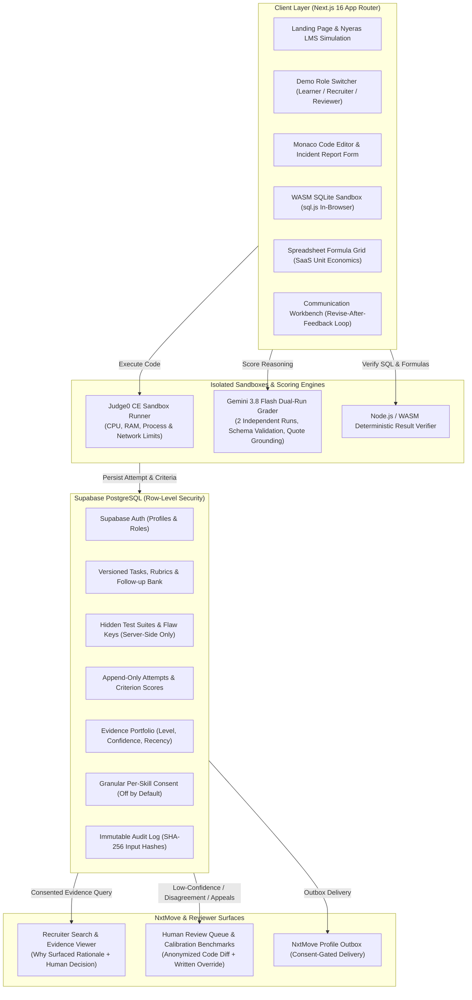

# ProofLoop (Nextlearn)

**Proof-of-Skill Sandbox & Learner-Owned Evidence Engine**  
*Samartha Hackathon, Part A: Nyeras / NxtMove Proof-of-Skill Sandbox*

ProofLoop is an authentic skill-verification sandbox where learners prove competencies through real work samples, deterministic test execution, and adaptive follow-up defenses. Evidence is scored against visible, versioned rubrics and shared with recruiters exclusively through revocable, granular learner consent.

> **Important Disclaimer**: Evidence describes demonstrated performance on these specific sandbox tasks only. It is experimental and is **not** a validated predictor of job performance, candidate intelligence, or automated hiring recommendations.

---

## Architecture Diagram



---

## Core Non-Negotiables & Design Principles

1. **No Points, XP, Badges, Streaks, or Leaderboards**: Skill progression and unlocks derive exclusively from demonstrated understanding.
2. **Tests Decide Correctness; AI Evaluates Reasoning Only**: Deterministic tests in Judge0 decide code correctness. Gemini evaluates written reasoning in two independent runs with structured schema validation and mandatory text quote citations.
3. **Zero Secret Leakage**: Hidden test suites, reference implementations, flaw lines, and follow-up answer keys never reach the client bundle or public API responses (enforced by `tests/leak-protection.test.ts`).
4. **Consent is Off by Default, Granular, and Revocable**: Sharing is per-skill, not all-or-nothing. Submissions (source code and incident reports) require explicit opt-in. Revocation immediately excludes candidate evidence from recruiter search.
5. **Follow-Up Questions Affect Confidence Only**: Adaptive follow-up questions from the fixed bank resolve ambiguity and adjust confidence (High/Medium/Low); the count of follow-ups never modifies the criterion score.
6. **Content-Only Evaluation**: Strict prompt guardrails forbid penalizing dialect, accent, phrasing style, or non-native English grammar.
7. **Append-Only Immutable Audit Trail**: Every assessment attempt, prompt hash, model output, consent modification, recruiter view, and reviewer override is permanently logged.
8. **Human Judgment Remains Authoritative**: The system never auto-rejects candidates; human decision-makers retain final authority.

---

## 7-Minute Demo Script (Minute-by-Minute Walkthrough)

This script is designed for hackathon judges to walk the entire end-to-end demo without friction.

| Minute | Time | Section & Role | Exact Actions & What to Show |
| :---: | :---: | :---: | :--- |
| **1** | 0:00 – 1:00 | **Elevator Pitch & LMS Handoff**<br>`(Learner)` | 1. Start on `/` (Overview). Highlight the 10-second elevator pitch, calm "Mission Control" palette, and visible disclaimers.<br>2. Click **"Nyeras LMS"** in the sidebar. Show the simulated course module *"Distributed Systems Debugging"*. Click **"Prove Your Skill in Sandbox →"** to demonstrate seamless LMS handoff. |
| **2** | 1:00 – 2:15 | **Debugging Mission & Monaco Editor**<br>`(Learner)` | 1. Open **"Missions"** → Incident 01 (*The wrong top seller*).<br>2. Toggle between **"Incident Story"** and **"Plain Task Specification"**.<br>3. Inspect visible acceptance tests and rubric.<br>4. Fix `for (let i = 0; i < values.length; i++)` in the **Monaco editor**.<br>5. Fill out the 4-part incident report headings.<br>6. Check *I used AI assistance*.<br>7. Click **"Submit incident report →"** to trigger live isolated tests in Judge0 and dual-run Gemini scoring. |
| **3** | 2:15 – 3:30 | **Skill Tree & Boss Round**<br>`(Learner)` | 1. Navigate to **"Skill tree"**. Show node states conveyed with icons and text (*"Evidenced"*, *"Available"*, *"Locked"*), never color alone.<br>2. Show **Boss Round** (*Catch the AI’s mistake*): explain how learner assertions run against 3 code versions (flawed, reference, and alternate) so trivial tests like `assert false` are rejected. |
| **4** | 3:30 – 4:45 | **New Paths & Authentic Work Samples**<br>`(Learner)` | 1. Click **"Learning paths"** in the sidebar.<br>2. Show all 3 paths (10 modules each with visible *"Draft curriculum content"* warnings).<br>3. Open **Data Analytics**: show the in-browser **WASM SQLite Sandbox** (`sql.js`). Click **"Run Query in WASM SQLite"** to execute against the live in-memory database and view the result table.<br>4. Open **Business Analytics**: demonstrate the interactive **Spreadsheet Formula Grid** (CAC, LTV, Payback period).<br>5. Open **Communication**: show the **Revise-After-Feedback Loop** on the P0 Incident memo. |
| **5** | 4:45 – 5:45 | **Evidence Portfolio & Granular Consent**<br>`(Learner)` | 1. Return to **"My evidence"**.<br>2. Show the multi-skill evidence cards: proficiency level, confidence, and recency without opaque single aggregate scores or XP.<br>3. Demonstrate granular consent: toggle sharing ON/OFF for `debugging` vs `data-analytics`.<br>4. Toggle the two-tier switch (*"Also share source code and written answers"*). Show immediate revocability. |
| **6** | 5:45 – 6:30 | **NxtMove Recruiter Search**<br>`(Recruiter)` | 1. Use the **Role Switcher** in the topbar to switch to **Priya Sharma (Recruiter)**.<br>2. Switch between **"Junior Java Developer"** and **"Junior Data Analyst"** roles.<br>3. Show surfaced candidates with explicit **"Why surfaced"** explanations.<br>4. Expand candidate evidence. Notice source code is visible only because the candidate opted into two-tier consent.<br>5. Enter a recruiter note and click **"Shortlist candidate"** to record an audited human hiring decision. |
| **7** | 6:30 – 7:00 | **Reviewer Queue, Calibration & Failure Scenarios**<br>`(Reviewer)` | 1. Switch role to **Dr. Sarah Chen (Reviewer)**.<br>2. Show **Review queue**: anonymized peer similarity diff and mandatory 10-character written override reason.<br>3. Inspect the **Calibration Panel**: AI vs Human raters across 6 benchmark submissions with agreement rates.<br>4. Visit **"Failure scenarios"**: trigger the interactive simulations for Prompt Injection and Trivial Boss Test to show the defense gates in action.<br>5. End on the immutable **Audit Log** showing cryptographic input hashes for every turn. |

---

## Environment Variables Configuration

Copy `.env.example` to `.env.local` and configure your credentials:

```dotenv
# Backend Operational Mode ('supabase' for live demo, 'local' for offline preview)
NEXT_PUBLIC_BACKEND_MODE=supabase

# Supabase Credentials (from Supabase Dashboard -> Project Settings -> API)
NEXT_PUBLIC_SUPABASE_URL=https://your-project.supabase.co
NEXT_PUBLIC_SUPABASE_ANON_KEY=eyJhbGciOi...
SUPABASE_SERVICE_ROLE_KEY=eyJhbGciOi...

# Isolated Code Sandbox (Judge0 CE v1.14.0 or private instance)
JUDGE0_BASE_URL=https://ce.judge0.com
JUDGE0_AUTH_TOKEN=

# Reasoning Evaluation Engine (Gemini API)
GEMINI_API_KEY=AIzaSy...
GEMINI_MODEL=gemini-3.8-flash

# Optional NxtMove Integration Endpoint
NXTMOVE_API_URL=
NXTMOVE_API_KEY=
```

> **Security Note**: `SUPABASE_SERVICE_ROLE_KEY`, `JUDGE0_AUTH_TOKEN`, and `GEMINI_API_KEY` are strictly server-side and are never prefixed with `NEXT_PUBLIC_`.

---

## Synthetic Demo Personas

Zero-friction testing is enabled via the topbar **Role Switcher** or credentials:

| Persona | Role | Synthetic ID | Email | Password |
| :--- | :---: | :---: | :--- | :--- |
| **Alex Morgan** | Learner | `cand_0142` | `alex.morgan.learner@nextlearn.synthetic` | `DemoPassword2026!` |
| **Rohan Mehta** | Learner | `cand_0981` | `rohan.mehta.learner@nextlearn.synthetic` | `DemoPassword2026!` |
| **Priya Sharma** | Recruiter | `rec_priya` | `priya.sharma.recruiter@nextlearn.synthetic` | `DemoPassword2026!` |
| **Dr. Sarah Chen** | Reviewer | `rev_sarah` | `sarah.chen.reviewer@nextlearn.synthetic` | `DemoPassword2026!` |

---

## Quality Gates & Verification Matrix

All quality gates pass before deployment:

| Gate | Command / Test Suite | Result | Status |
| :--- | :--- | :---: | :---: |
| **Linter** | `npm run lint` | 0 errors | **PASS** |
| **Type Check & Build** | `npm run build` | 21 routes compiled | **PASS** |
| **Leak Protection** | `tests/leak-protection.test.ts` | 5 tests passed | **PASS** |
| **Two-User RLS** | `tests/two-user-rls.test.ts` | 3 tests passed | **PASS** |
| **Consent & Profile** | `tests/consent-and-profile.test.ts` | 4 tests passed | **PASS** |
| **Recruiter Workflow** | `tests/recruiter-search.test.ts` | 4 tests passed | **PASS** |
| **Work Samples** | `tests/work-samples.test.ts` | 7 tests passed | **PASS** |
| **Stop Rule & Confidence** | `tests/stop-rule-and-confidence.test.ts` | 6 tests passed | **PASS** |
| **Follow-up Selector** | `tests/followup-selector.test.ts` | 4 tests passed | **PASS** |
| **Reviewer & Audit** | `tests/reviewer-and-audit.test.ts` | 3 tests passed | **PASS** |
| **Accessibility (WCAG AA)** | `tests/accessibility.test.ts` | 3 tests passed | **PASS** |
| **Total Test Count** | `npm test` | **39 / 39 tests** | **100% PASS** |

---

## Known Limitations & Honest Boundaries

1. **No Claims of Predictive Hiring Validity**: Performance in these sandboxes demonstrates skill on these simulated tasks only. We do not claim this score predicts general on-the-job performance.
2. **Benchmark Table is Preliminary**: The 15-case benchmark table on `/` (Validation) is a synthetic calibration set. Real statistical generalization requires a multi-institution empirical cohort study.
3. **Draft Curriculum Content**: Learning modules in the three practice paths are labeled *draft, needs human curriculum review*. Real skill verification occurs in the authentic work-sample sandboxes.
4. **Sandboxed Isolation**: Non-technical qualities such as teamwork, cross-functional diplomacy, and multi-month persistence cannot be measured within short individual sandboxes.
