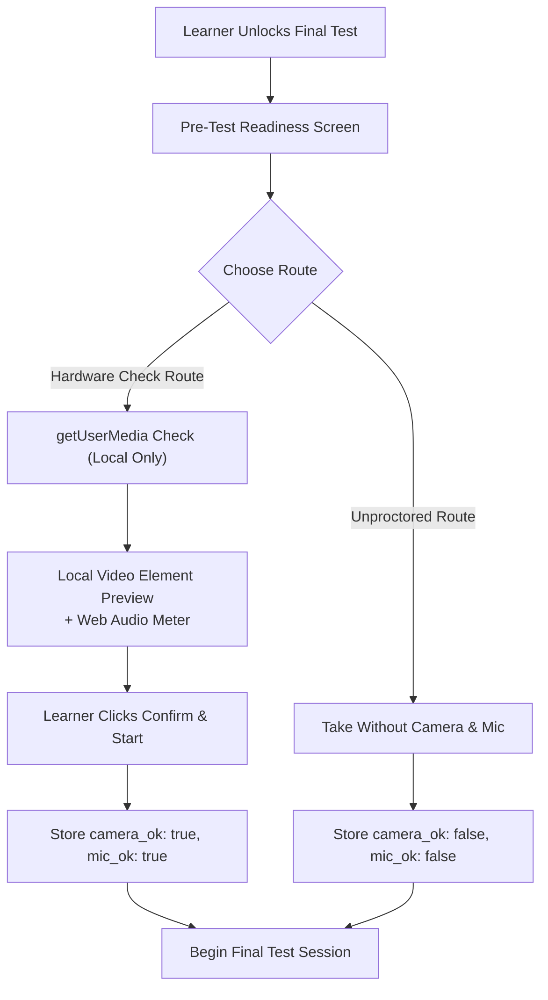

# Final Test Experience: Architecture & Implementation Plan

**Document:** `docs/FINAL_TEST_PLAN.md`  
**Author:** Senior Full-Stack Engineer, Assessment Designer & Product Designer  
**Date:** October 2026  
**Status:** In Progress — Phase 0 Planning Complete  

---

## 1. Executive Summary & Critical Policy Overrides Notice

This document defines the architecture and implementation specification for the **FINAL TEST** of each Learning Path (**Data Analytics**, **Business Analytics**, and **Workplace Communication**) in **NextLearn (ProofLoop)**.

The Final Test serves as the capstone proof-of-skill gate for each path. It unlocks strictly after a learner has demonstrated thorough foundational understanding by completing:
1. **All 10 modules** of that path (passing each module's knowledge check), and
2. **All 3 reflection checkpoints** (Checkpoints 1, 2, and 3 / Capstone) with genuine reflective submissions.

---

### CRITICAL POLICY OVERRIDES NOTICE
> [!IMPORTANT]
> **DELIBERATE OVERRIDES OF THREE EARLIER PROJECT RULES — FOR FINAL TESTS ONLY:**  
> This feature intentionally and explicitly overrides three earlier core project rules **STRICTLY AND EXCLUSIVELY FOR FINAL TESTS**.
> 
> 1. **"No Timers" Override $\rightarrow$ Authoritative Server-Side Time Limit:**
>    - Final tests are timed to evaluate operational readiness under realistic workplace bounds.
>    - Default duration: **45 minutes** for 8 questions (or 5–10 configurable).
>    - Clock authority rests **100% on the server** (calculated via `started_at` and `expires_at` timestamps). Client clock tampering cannot extend the test.
>    - UI provides calm, respectful countdown and non-intrusive warnings at **10 minutes** and **2 minutes** remaining. On expiration, the attempt auto-submits current answers.
>    - Accommodations: Learners requiring accessibility adjustments receive **+50% extended time (67.5 minutes)** via user settings.
> 
> 2. **"Hints Are Not Penalised" Override $\rightarrow$ Tiered Hint Mark Deductions:**
>    - While learning modules encourage unpenalized exploration, the Final Test assesses independent mastery.
>    - Hints have structured point deductions per question:
>      - **Tier 1 (Nudge):** 5% deduction
>      - **Tier 2 (Pointer):** 10% deduction
>      - **Tier 3 (Strong Hint):** 20% deduction
>      - **Hard Cap:** Cumulative hint deductions are capped at **35% maximum** per question.
>    - Before any hint is revealed, an explicit confirmation modal displays the exact point deduction, requiring deliberate learner confirmation.
> 
> 3. **"No Camera / Microphone" Override $\rightarrow$ Pre-Test Hardware Device Check:**
>    - A client-side hardware check verifies video and microphone availability using standard browser `navigator.mediaDevices.getUserMedia`.
>    - **ABSOLUTE PRIVACY NON-NEGOTIABLES:**
>      - **Zero Media Recording:** `MediaRecorder` is never called.
>      - **Zero Snapshot / Canvas Capture:** Video streams are never drawn to canvas, converted to blobs, base64-encoded, or stored in any format.
>      - **Zero Audio Capture:** Audio is only analyzed locally for volume peaks via a standard `AudioContext` / `AnalyserNode`.
>      - **Zero WebRTC Upload:** Streams never leave the browser. No video, audio, or biometric data is ever transmitted to Supabase, Gemini, or any server.
>      - **Zero Biometrics / Emotion AI:** No facial recognition, eye tracking, emotion detection, or room scanning algorithms exist.
>      - **Server Storage:** Only a boolean tuple (`camera_ok: boolean`, `mic_ok: boolean`, `verified_at: string`) is recorded on the attempt.
>      - **Unproctored Route:** A neutrally-labeled "Take without camera and microphone" option is always available with full access to test completion and evidence generation.
>      - **CI Pipeline Guard:** An automated CI test inspects the codebase to guarantee that no media recording, capture, or streaming endpoints exist.
> 
> **ALL OTHER NON-NEGOTIABLES REMAIN ABSOLUTE:**
> - Consent is OFF by default, per-skill, and revocable.
> - Recruiter views show consented evidence only.
> - No ranking numbers, XP, or leaderboards.
> - Follow-up question count never alters marks; it affects confidence only.
> - Content-only scoring: zero penalties for grammar, accent, dialect, or non-native phrasing.
> - Append-only audit log for all scoring and attempt events.

---

## 2. Gap Analysis: Current State vs. Target Final Test

| Dimension | Current State | Target Final Test Specification |
| :--- | :--- | :--- |
| **Path Completion Gate** | Module 10 ends with reflection; no capstone test exists. | Final Test unlocks only when all 10 modules + 3 reflections are completed. |
| **Question Pool & Delivery** | Knowledge checks are static 3 MCQs bundled client-side. | Bank of $\ge 24$ questions per path; 8 questions drawn randomly, balanced by type and difficulty. Delivered **one at a time from the server**. |
| **Answer Key Protection** | Learning checks rotate client choices; explanation keys are exposed in module json. | **Zero leak architecture**: Question prompts only are sent to client. Planted error keys, broken queries, reference solutions, and follow-up keys reside server-only. |
| **Question Typology** | Single-choice MCQs only. | 6 rich authentic formats: (1) Spot AI Mistake, (2) Case Decision, (3) Fix It (SQL/Formula/Draft), (4) Interpret Data, (5) Triage/Prioritise, (6) Rewrite. |
| **Adaptive Defense** | Follow-ups used only on debugging incident missions. | 1 to 3 ordered follow-ups per final test question with fixed expected key points and early-stop rule for high confidence. |
| **Scoring Rigor** | Binary pass/fail (2 of 3 correct). | 100-point scale: Non-coding = 80 base (error identification/rationale/fix) + 20 follow-up defense; Coding = 60 correctness + 40 optimality (execution plan, time/space complexity). |
| **Device Readiness** | No camera/mic capability. | Local-only device preview with audio level meter, privacy guarantee, and unproctored alternative. |
| **Focus & Integrity** | 3-second grace focus engine exists for modules. | Reused focus engine: server clock countdown (45 min), 5s heartbeat, 3s grace tab-switch guard. Accidental exit $>3$s locks attempt as Interrupted with 24h cooldown. |
| **Evidence Profile** | Evidence cards only for debugging missions. | Learner evidence cards populated with Final Test skill tier (Developing 50-69, Proficient 70-84, Advanced 85+) and confidence level. |

---

## 3. Test Structure & Question Formats

### 3.1 Path Question Pools ($\ge 24$ questions per path)
- **Data Analytics:** 24+ questions spanning SQL correctness, query performance, cohort analysis, data cleanliness, visualization interpretation, and metric triage.
- **Business Analytics:** 24+ questions covering unit economics (CAC/LTV/Payback), pricing sensitivity, spreadsheet formulas, cohort retention, and investment trade-offs.
- **Workplace Communication:** 24+ questions covering executive escalations, asynchronous status updates, cross-functional translations, customer apology rewrites, and AI email triage.

### 3.2 Six Core Question Archetypes
1. **Spot the AI's Mistake:**
   - AI draft with planted errors (hallucinated metric, faulty arithmetic, flawed causality).
   - Learner highlights faulty text/numbers $\rightarrow$ deterministic check against planted error span.
   - Learner explains why it is wrong and provides the correction $\rightarrow$ Gemini dual-run scoring against rubric.
2. **Case Decision:**
   - Real-world scenario under ambiguity.
   - Learner selects a decision option and authors an evidence-based written justification.
3. **Fix It:**
   - Broken SQL query (syntax, join fan-out, missing group-by), broken spreadsheet formula (`VLOOKUP` vs `XLOOKUP`, bad ranges), or flawed policy draft.
   - Correctness tested via in-engine execution (WASM SQLite or spreadsheet evaluator) + Optimality grading.
4. **Interpret:**
   - Misleading chart, distorted axis, or aggregated Simpson's paradox table.
   - Learner provides written breakdown of what the chart claims vs what the underlying data actually conceals.
5. **Triage / Prioritise:**
   - Conflicting requests, tight deadlines, or resource caps.
   - Learner ranks items and defends the trade-offs and discarded priorities.
6. **Rewrite:**
   - Unclear, defensive, overly technical, or insensitive workplace communication.
   - Learner rewrites for clarity, empathy, and executive brevity.

---

## 4. Scoring Engine, Optimality & Dual-Run AI

### 4.1 Scoring Allocation (100 Points per Question)
- **Non-Coding / Qualitative Tasks:**
  - **Base Answer (80 Points):**
    - Error location / primary choice: 35 points (deterministic matching)
    - Root cause / rationale: 25 points (AI-graded against rubric)
    - Correction / proposed solution: 20 points (AI-graded against rubric)
  - **Follow-Up Reasoning Defense (20 Points):**
    - Demonstrated depth across adaptive follow-up prompts.
- **Coding / SQL / Formula Tasks:**
  - **Correctness (60 Points):** Deterministic execution matching expected dataset / numeric result.
  - **Optimality (40 Points):**
    - SQL: Query plan inspection, avoidance of `SELECT *`, index utilization, filtering before grouping, absence of redundant Cartesian joins.
    - Formulas: Efficiency, avoidance of volatile functions, dynamic arrays, resilience to inserted columns.
    - Code: Time/space complexity within specified bounds ($O(N)$ vs $O(N^2)$).
    - If correct and optimal: **100 points**. If correct but inefficient: **60 points**.

### 4.2 Gemini Dual-Run Pipeline
- Dual independent calls (`twoValidatedRuns`) with `temperature: 0`.
- Zod schema validation ensuring required evidence quotes extracted from learner text.
- If both runs agree within 15 points, average is accepted.
- If runs disagree by $>15$ points or prompt manipulation is flagged, attempt is flagged for **Human Reviewer Queue**.

### 4.3 Adaptive Follow-Up Engine & Early Stop Rule
- Up to 3 follow-ups drawn sequentially based on previous responses.
- **Early-Stop Rule:** If the base response and first follow-up achieve full marks ($\ge 90\%$) with high consensus across runs, follow-up questioning terminates immediately with **High Confidence**.
- **Confidence Matrix:**
  - High Confidence: Base answer strong, follow-up defended, zero run discrepancies.
  - Medium Confidence: Minor ambiguity resolved in follow-up, or 1 hint utilized.
  - Low Confidence / Pending Review: Divergent model runs, suspected injection, or unresolved follow-ups.
- **Crucial Rule:** Follow-up count never lowers or raises points; it calibrates confidence only.

---

## 5. Focus Engine, Time Limits & Integrity

### 5.1 Server-Authoritative Clock
- Attempt duration: `time_limit_seconds` (default 2700s = 45m; 4050s = 67.5m with accommodation).
- Server validates `now() <= started_at + time_limit_seconds + 10s buffer`.
- Responses received after expiry are rejected, and test status is finalized as `timed_out`.

### 5.2 Presence & Interruption Protection
- Heartbeat ping every 5 seconds. Timeout after 30 seconds of silence.
- Page Visibility API & window blur detection with a **3-second grace period**.
- Exceeding grace period ($> 3\text{s}$) terminates the attempt immediately as `interrupted`.
- **Attempt Limit & Cooldown:**
  - Maximum **3 attempts per 7 days**.
  - Enforced **24-hour cooldown** following any interrupted or completed test.

---

## 6. Pre-Test Device Check & Absolute Privacy

- **No Media Upload CI Guard:** Automated test in Vitest ensures zero calls to `MediaRecorder`, zero canvas extraction (`toDataURL`, `getImageData`), and zero video streaming routes.

---

## 7. Database Migration & Schema (`supabase/migrations/202610100009_final_tests.sql`)

1. `final_test_configs`: Path slug, time limits, question count, pass threshold.
2. `final_test_questions`: Question pool, type, prompt, options, difficulty, status. (Draft: needs human review).
3. `final_test_secrets`: Server-only table storing planted error keys, SQL solutions, optimality criteria, follow-up banks, and hint contents. (Never exposed via API).
4. `final_test_attempts`: User ID, path slug, start time, expiration, state, time remaining, camera/mic verified flags, hint count.
5. `final_test_answers`: Learner responses per question, base score, optimality score, hint deductions, follow-up answers, confidence, dual AI runs.
6. `final_test_audit`: Append-only event stream of all test lifecycle events.

---

## 8. Implementation Phases

- **Phase 0:** Architecture Plan (`docs/FINAL_TEST_PLAN.md`) [Current]
- **Phase 1:** Database Schema, Authoring Types & Question Pool Vertical Slice
- **Phase 2:** Device Check Modal, Authoritative Server Timer & Focus Shell
- **Phase 3:** Scoring Engine, Optimality Evaluation & Adaptive Follow-Up Pipeline
- **Phase 4:** Tiered Hints, Results Breakdown & Challenge / Reviewer Route
- **Phase 5:** Full 24+ Question Pools for Data, Business, and Communication Paths
- **Phase 6:** Accessibility Accommodations, Cooldown Enforcement & Unproctored Route
- **Phase 7:** Automated Test Suite (Leak Tests, Proctoring Guard, Timing Tests) & Build Verification

---

## 9. Risk Mitigation Matrix

| Identified Risk | Impact | Mitigation Strategy |
| :--- | :--- | :--- |
| **Client Answer Leakage** | Compromised test integrity | Secrets table with server-side isolation; test question API returns only prompt & choices. Automated leak test in CI. |
| **Browser Media Permission Failure** | Learner blocked from starting | Unproctored route readily available; explicit fallback instructions for denied permissions. |
| **Model Hallucination / Timeout** | Delayed test scoring | Strict Zod validation; deterministic grading for objective components; offline fallback for tests; automatic reviewer queue routing for divergence. |
| **Network Flake on Expiry** | Lost learner work | Client auto-submits at 10 seconds before expiry; server gracefully accepts in-flight payloads with small network skew buffer. |
