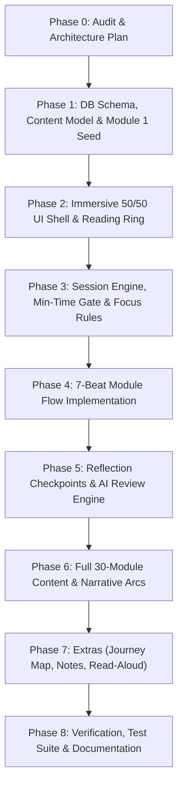

# Learning Experience Overhaul: Architecture & Implementation Plan

**Document:** `docs/LEARNING_PLAN.md`  
**Author:** Senior Product Designer, Learning-Experience Designer & Full-Stack Engineer  
**Date:** October 2026  
**Status:** Completed — All Phases 0 through 8 Verified & Production Ready

---

## 1. Executive Summary & Policy Override Notice

This document defines the comprehensive architecture and rollout plan for redesigning the three Learning Paths (**Data Analytics**, **Business Analytics**, and **Workplace Communication**; 10 modules each) in **NextLearn (ProofLoop)** into an immersive, story-driven, focused "software-like" learning experience.

### CRITICAL POLICY OVERRIDE NOTICE
> [!IMPORTANT]
> **DELIBERATE OVERRIDE OF PROJECT RULES FOR LEARNING MODULES ONLY:**  
> This implementation deliberately overrides two earlier project non-negotiables (**"no timers"** and **"no time-based unlocks"**) **STRICTLY AND EXCLUSIVELY FOR LEARNING MODULES AND REFLECTIONS**.
> 
> - **Scope Limitation:** The minimum reading-time pacing ring, server-side advance gates, and no-tab-switch focus rules apply **ONLY** to instructional learning modules and formative reflections.
> - **Total Independence of Evidence & Assessments:** Debugging incident missions, Judge0 test verification, Gemini reasoning assessments, Boss Round challenges, criterion confidence ratings, learner evidence cards, audit logs, reviewer queues, and recruiter search views remain **COMPLETELY UNAFFECTED**.
> - **Strict Privacy of Pacing & Focus Data:** All timing metrics, pause counts, relaxed mode preferences, and tab-switch interruption records are **private to the individual learner**. They are used exclusively to enforce session continuity and are **NEVER** shared with recruiters, reviewers, or third parties, and **NEVER** factored into proficiency scores, confidence meters, or candidate rankings.

---

## 2. Gap Analysis: Current State vs. Target State

| Dimension | Current Implementation | Target Experience Specification |
| :--- | :--- | :--- |
| **Workspace Layout** | Standard container with left sidebar, module listing on top, and vertical scroll. | **Immersive Half-and-Half Fullscreen**: Left panel on Midnight (`#142D4E`) with dynamic SVG scenes, characters, and story; Right panel on White (`#FFFFFF`) for learning beats. Sidebar hidden, thin top bar with calm step dots and reading ring. |
| **Module Structure** | Single static text block (2 headings) followed by an optional 3-question MCQ modal. | **7-Beat Paged Sequence**: (1) Curiosity Teaser $\rightarrow$ (2) Story Scene $\rightarrow$ (3) Core Concept $\rightarrow$ (4) Step-by-Step Worked Example $\rightarrow$ (5) Try-It Activity $\rightarrow$ (6) Knowledge Check (2/3 pass) $\rightarrow$ (7) Takeaway & Reflection note. |
| **Reading Pacing** | Instant click-through; learners can jump straight to questions without reading. | **Server-Enforced Minimum Reading Time**: Paced by `clamp(ceil(words / 3.8 * 0.6), 8, 90)` seconds with a calm fill-up circular ring. Server tracks `page_enter` and `page_advance` and rejects client tampering. |
| **Focus & Presence** | Learner can leave the tab, switch windows, or run multiple tabs indefinitely. | **Strict but Fair Focus Engine**: Page Visibility API + blur + document.hasFocus + 5s heartbeat. 3-second grace period for accidental switches; single-session lock; deliberate Pause button; Relaxed Focus mode for accessibility. |
| **Formative Reflection** | No intermediate checkpoints; learning paths end after module 10. | **AI-Reviewed Reflection Checkpoints** after Modules 3, 6, 9, and 10. 3-sentence structured synthesis evaluated by Gemini Flash with formative coaching (genuine check, understanding tier, strength/gap/review link). |
| **Narrative Arcs** | Generic disjointed scenarios. | **Continuing Character Arcs**: Data ("The Missing Orders" with Meera), Business ("The Tea Stall That Wanted to Grow" with Ravi), Communication ("The Update Nobody Read" with Kiran), plus interactive decision branches. |
| **Story vs. Plain View** | Only plain text available. | **Story/Plain Mode Toggle**: Instantly switch between the rich narrative split-screen and clean plain-text lesson mode. |
| **Extras** | None. | Journey Map, Private Notebook, SpeechSynthesis Read-Aloud, "Explain It Back" micro-prompts, Revisit suggestions. |

---

## 3. Data Architecture & Migrations

### 3.1 New Database Tables (`supabase/migrations/202610100008_learning_experience.sql`)

```sql
-- 1. Learner Module Sessions (Active / Paused / Interrupted / Completed)
CREATE TABLE public.learning_module_sessions (
  id UUID PRIMARY KEY DEFAULT gen_random_uuid(),
  user_id UUID NOT NULL REFERENCES public.profiles(id) ON DELETE CASCADE,
  path_slug TEXT NOT NULL,
  module_slug TEXT NOT NULL,
  state TEXT NOT NULL CHECK (state IN ('active', 'paused', 'interrupted', 'completed')),
  current_page_type TEXT NOT NULL,
  current_page_index SMALLINT NOT NULL DEFAULT 0,
  pauses_used SMALLINT NOT NULL DEFAULT 0,
  relaxed_mode BOOLEAN NOT NULL DEFAULT FALSE,
  interrupt_reason TEXT,
  session_token UUID NOT NULL DEFAULT gen_random_uuid(),
  last_heartbeat_at TIMESTAMPTZ NOT NULL DEFAULT now(),
  started_at TIMESTAMPTZ NOT NULL DEFAULT now(),
  ended_at TIMESTAMPTZ
);

-- 2. Page Visits (Server-Enforced Time Gate)
CREATE TABLE public.learning_page_visits (
  id UUID PRIMARY KEY DEFAULT gen_random_uuid(),
  session_id UUID NOT NULL REFERENCES public.learning_module_sessions(id) ON DELETE CASCADE,
  user_id UUID NOT NULL REFERENCES public.profiles(id) ON DELETE CASCADE,
  page_index SMALLINT NOT NULL,
  page_type TEXT NOT NULL,
  min_seconds SMALLINT NOT NULL,
  server_enter_at TIMESTAMPTZ NOT NULL DEFAULT now(),
  server_advance_at TIMESTAMPTZ,
  interaction_completed BOOLEAN NOT NULL DEFAULT FALSE
);

-- 3. Interruption Logs (Auditing Focus Breaks)
CREATE TABLE public.learning_interruptions (
  id UUID PRIMARY KEY DEFAULT gen_random_uuid(),
  session_id UUID NOT NULL REFERENCES public.learning_module_sessions(id) ON DELETE CASCADE,
  user_id UUID NOT NULL REFERENCES public.profiles(id) ON DELETE CASCADE,
  interruption_type TEXT NOT NULL CHECK (interruption_type IN ('tab_hidden', 'window_blur', 'pagehide', 'heartbeat_lost', 'second_session')),
  occurred_at TIMESTAMPTZ NOT NULL DEFAULT now(),
  duration_ms INTEGER NOT NULL DEFAULT 0,
  grace_period_exceeded BOOLEAN NOT NULL DEFAULT TRUE
);

-- 4. Teaser Commitments (Private, Unscored)
CREATE TABLE public.learning_teaser_responses (
  id UUID PRIMARY KEY DEFAULT gen_random_uuid(),
  user_id UUID NOT NULL REFERENCES public.profiles(id) ON DELETE CASCADE,
  path_slug TEXT NOT NULL,
  module_slug TEXT NOT NULL,
  format TEXT NOT NULL,
  selected_option TEXT,
  free_text TEXT,
  committed_at TIMESTAMPTZ NOT NULL DEFAULT now()
);

-- 5. Formative Reflection Checkpoints (AI-Only Feedback)
CREATE TABLE public.learning_reflections (
  id UUID PRIMARY KEY DEFAULT gen_random_uuid(),
  user_id UUID NOT NULL REFERENCES public.profiles(id) ON DELETE CASCADE,
  path_slug TEXT NOT NULL,
  after_module SMALLINT NOT NULL,
  reflection_text TEXT NOT NULL,
  ai_feedback JSONB NOT NULL,
  status TEXT NOT NULL CHECK (status IN ('submitted', 'skipped')),
  created_at TIMESTAMPTZ NOT NULL DEFAULT now()
);

-- 6. Private Notebook Notes
CREATE TABLE public.learning_notes (
  id UUID PRIMARY KEY DEFAULT gen_random_uuid(),
  user_id UUID NOT NULL REFERENCES public.profiles(id) ON DELETE CASCADE,
  path_slug TEXT NOT NULL,
  module_slug TEXT NOT NULL,
  note_text TEXT NOT NULL,
  updated_at TIMESTAMPTZ NOT NULL DEFAULT now()
);
```

### 3.2 Row Level Security (RLS) Isolation
- **Learner-Only Access:** All learning tables enforce `user_id = auth.uid()` for `SELECT`, `INSERT`, `UPDATE`.
- **Recruiter & Reviewer Lockdown:** Recruiter and Reviewer roles have **0 access** (revoked at schema level).
- **Service Role:** Server API endpoints run under elevated service privileges to validate timestamps and enforce security boundaries.

---

## 4. API Endpoints Specification

1. `POST /api/learn/session/start`:
   - Validates module readiness (prior module passed, or module 1).
   - Terminates any conflicting active session for the learner with `interrupt_reason: 'second_session'`.
   - Creates a new session record and returns a signed `sessionToken`.
2. `POST /api/learn/page/enter`:
   - Records `server_enter_at` timestamp on `learning_page_visits`.
   - Returns calculated `min_seconds` for the client fill-up ring.
3. `POST /api/learn/page/advance`:
   - Evaluates: `now() - server_enter_at >= min_seconds` (ignoring client clocks).
   - Verifies required interaction is marked complete (e.g. teaser option committed).
   - Rejects with `400 Pacing Gate Active` if requested too early.
4. `POST /api/learn/session/heartbeat`:
   - Updates `last_heartbeat_at`.
   - Verifies session is still active and token is valid.
5. `POST /api/learn/session/interrupt`:
   - Logs interruption event.
   - If duration exceeds grace period (3,000ms), transitions session state to `interrupted`.
6. `POST /api/learn/session/pause` & `POST /api/learn/session/resume`:
   - Validates that pause is requested between content pages (blocked during Quiz and Reflection).
   - Allows max 1 pause per attempt.
7. `POST /api/learn/reflection/submit`:
   - Validates length ($\ge 25$ words, 3 sentences/lines with multi-language punctuation support).
   - Evaluates text using Gemini 3.8 Flash with structured Zod schema output.
   - Detects lesson text copying with deterministic Levenshtein/Jaccard similarity.
   - Unlocks next module upon genuine submission.

---

## 5. Implementation Phases & Commit Schedule



- **Phase 0:** Audit, gap list, and `docs/LEARNING_PLAN.md` (*Completed*).
- **Phase 1:** Database migration, content types, server API scaffolding, and complete vertical slice of Module 1 across all 3 paths.
- **Phase 2:** Full-page half-and-half layout, SVG scene renderer, calm reading-time progress ring, Story/Plain toggle, mobile responsive switcher.
- **Phase 3:** Server-side minimum time gate, heartbeat tracker, focus detection with 3s grace period, single-session lock, pause mechanism, and relaxed accessibility mode.
- **Phase 4:** Interactive 7-beat module engine: teaser committing, concept glossary tooltips, worked examples, interactive try-it activities, 2-of-3 knowledge check, and takeaway cards.
- **Phase 5:** AI reflection checkpoints after modules 3, 6, 9, 10, Gemini formative review with Zod schema validation, and "My Reflections" evolution tracker.
- **Phase 6:** Complete authoring of all 10 modules across Data Analytics, Business Analytics, and Communication (marked *"Draft: needs human review"*), with branch decision trees.
- **Phase 7:** Journey map visualizer, private notebook, SpeechSynthesis read-aloud integration, and revisit prompts.
- **Phase 8:** Vitest unit tests, Playwright focus/interruption scenarios, accessibility check, build verification, and README updates.

---

## 6. Risk Mitigation Matrix

| Potential Risk | Severity | Technical Defense & Mitigation |
| :--- | :--- | :--- |
| **Client Device Clock Manipulation** | High | Minimum reading time is strictly calculated and enforced on the server using PostgreSQL `timestamptz`. The client time is never trusted. |
| **False Positive Tab Switches on Mobile** | Medium | Configurable 3,000ms grace period absorbs notification shade pulls or momentary app-switch swipes without killing the session. |
| **AI Formative Review Latency or Failure** | Medium | Gemini evaluation is given a strict 8s timeout with 1 automatic retry; if down, gracefully falls back to unlocking the module with *"Feedback temporarily unavailable"*. |
| **Prompt Injection in Reflections** | High | User reflection inputs are strictly enclosed within structural delimiters, system instructions enforce JSON output only, and inputs are checked for manipulation patterns. |
| **Accessibility Barrier from Strict Focus** | High | One-click "Relaxed Focus Mode" is available to any learner with zero justification required, disabling tab locks and halving reading times. |

---

*End of Plan. Proceeding to Phase 1: Database Migration, Content Model, and Vertical Slice.*
