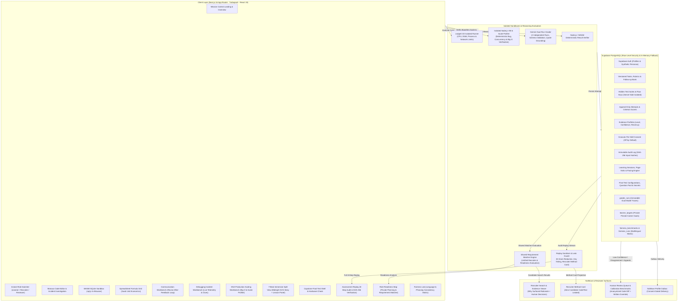

# ProofLoop (NextLearn) — Comprehensive Project Summary

**ProofLoop (NextLearn)** is an authentic, learner-owned **Proof-of-Skill Sandbox, Evidence Engine, and Auditable Skill-Verification Platform** built for the **Samartha Hackathon (Part A: Nyeras / NxtMove Sandbox)**.

The platform eliminates multiple-choice trivia and opaque gamified proxies in favor of **authentic, task-based work samples**, deterministic test execution, and adaptive oral/written defenses. Learners generate **criterion-level evidence** that is shared with recruiters strictly under **granular, revocable learner consent**. Every evaluation is verifiable down to the cryptographic SHA-256 hash of its inputs, independent dual AI grader runs, and transparent fairness benchmarks across regional languages and phrasing styles.

> **Important Boundary & Disclaimer**: Demonstrated skills reflect performance on these specific sandbox challenges only. ProofLoop explicitly claims **no automated hiring predictions** and **no general intelligence evaluation**. Human judgment remains the final authority.

---

## 1. High-Level Architecture & Tech Stack

### Technical Foundation
- **Framework:** Next.js 16 (App Router + Turbopack), React 19, TypeScript.
- **Styling & Tokens:** Strict 10-token CSS variable design system (`--white`, `--midnight`, `--cyan`, `--ice`, `--text`, `--muted`, `--border`, `--success`, `--warning`, `--error` and defined opacity tints), Lucide icons, full WCAG 2.1 AA accessibility.
- **Database & RLS:** Supabase PostgreSQL with Row-Level Security (RLS) policies, server-side admin client, and seamless in-memory fallback stores for test and offline environments.
- **Execution Engines:**
  - **Judge0 CE v1.14.0:** Isolated sandboxed code execution for Java & JavaScript with CPU, RAM, and process constraints.
  - **Node.js Isolated VM & Scale Profiler:** Sub-millisecond deterministic execution sandbox with execution timeouts (<80ms benchmark constraints for $O(N)$ vs $O(N^2)$ checks), memory profiling, and server-side edge-case verification.
  - **sql.js (WASM SQLite):** In-browser query engine with deterministic row verification.
  - **Google Gemini Dual-Run Pipeline:** Structured dual-run JSON evaluation with Zod schema validation, quote citation grounding, and multilingual content-only scoring.

---

## 2. Core Non-Negotiables & Ethical Principles

1. **No Gamification Pressure:** Zero points, XP, streaks, levels, leaderboards, percentile rankings, or countdown timers (outside of designated module reading pacing and final tests). Progression derives **strictly from demonstrated understanding**.
2. **Deterministic Correctness; AI for Reasoning Only:** Code and math correctness is evaluated 100% deterministically by tests and query plans. Gemini evaluates *written justifications and diagnostic rationale only* via two independent runs.
3. **Zero Secret Leakage:** Hidden test suites, reference implementations, planted bug lines, expected results, and follow-up answer keys never reach the client bundle or public API responses (guaranteed by CI leak protection tests and server-side N-gram redaction).
4. **Consent-Gated Privacy (Off by Default):**
   - Sharing is per-skill, granular, and instantly revocable.
   - Code submissions and incident reports require separate secondary consent.
   - Recruiters see consented evidence only; candidate targets and gap analysis are private and never shared.
5. **Adaptive Follow-Up Questions Affect Confidence Only:** Follow-up questions resolve ambiguity and adjust confidence tiers (High / Medium / Low). They **never reduce the base criterion score**.
6. **Linguistic Neutrality:** Grader prompts strictly prohibit penalizing dialect, phrasing style, colloquialisms, or non-native English grammar. Semantic technical content is evaluated in original scripts (English, Hindi Devanagari, Telugu, Hinglish).
7. **Immutable Audit Trail:** Append-only audit log recording every submission, model output, input SHA-256 hash, consent change, and human review override.
8. **Human Judgment is Authoritative:** Automated systems cannot reject candidates; final hiring decisions remain human-driven.

---

## 3. Five Core Functional Pillars

### Pillar 1: Incident Debugging Sandbox (Technical Depth)
- **4 Real-World Incident Missions:**
  1. *The Wrong Top Seller* (JavaScript / API Sorting & Pagination)
  2. *Payment Double Charge* (Java / Concurrency & Idempotency)
  3. *Cache Invalidation Nightmare* (JavaScript / Redis Key TTLs)
  4. *Inventory Deadlock* (Java / SQL Transaction Order)
- **Dual-View Workspace:** Seamless toggle between **Incident Story** and **Plain Task Specification**.
- **Monaco Code Editor:** Embedded IDE with syntax highlighting, test execution, and real-time error feedback.
- **4-Part Incident Report:** Learners document Summary, Root Cause, Fix Rationale, and Verification Steps.
- **Skill Tree & Boss Round:** Prerequisite-based unlock visualization. Features *"Catch the AI's Mistake"* where candidate assertions execute against 3 code versions (flawed, reference, alternate) to defeat trivial cheats like `assert false`.
- **Reviewer Appeals & Dispute Workflow:** Instant routing of low-confidence or candidate-challenged evaluations to human reviewers.

---

### Pillar 2: Immersive Learning Paths, Workbenches & Focus Engine
- **5 Comprehensive Practice Paths:**
  1. **Data Analytics:** 10 modules on SQL queries, schema design, metric calculations, and business dashboards.
  2. **Business Analytics:** 10 modules on unit economics, CAC/LTV, Cohort retention, and sensitivity models.
  3. **Workplace Communication:** 10 modules on executive BLUF, de-escalation, cross-functional briefs, and active feedback loops.
  4. **Hands-on Incident Debugging (The FinFlow War Room):** 4 story modules tackling production payment, concurrency, payload crash, and event ordering incidents.
  5. **Data Structures & Algorithms in Production (Scaling EventPulse):** 4 practical modules on high-throughput deduplication, priority queues, sliding window rate limits, and binary search log indexing.
- **Split-Screen Immersive View:**
  - **Left (Midnight `#142D4E`):** Original SVG illustrations and ongoing narrative arcs (*Meera at Quickbite*, *Rohan at ChaiCraft*, *Ananya at CloudScale*, *Kavya Nair at FinFlow*, *Tariq Patel at EventPulse*) featuring interactive decision branches that immediately register learner commitment.
  - **Right (Clean White Canvas):** 7-beat pedagogical lesson progression:
    1. *Curiosity Teaser* (predict before seeing the lesson)
    2. *Story Scene* (contextual workplace narrative with recurring engineering characters)
    3. *Core Concept* (bite-sized principles with interactive glossary popovers)
    4. *Worked Example* (production scenario walkthrough)
    5. *Try-It First* (low-stakes interactive trial with live incident symptoms and code inspection)
    6. *Knowledge Check* (server-graded formative check, pass 2 of 3 to advance)
    7. *Key Takeaway* (summary card)
- **Authentic Interactive Work Samples & Workbenches:**
  - **WASM SQLite (`sql.js`):** In-browser SQL execution on live eCommerce order tables.
  - **Spreadsheet Formula Grid:** Interactive formula evaluation for SaaS metrics (CAC, LTV, Payback).
  - **Communication Workbench:** Revise-after-feedback loop on critical stakeholder memos.
  - **Debugging Incident Workbench (`DebuggingWorkbench`):** Live incident telemetry, unfolding clues, interactive code editor with reset and patch injection, isolated Node.js VM deterministic test runner, 4-part incident report documentation, and adaptive follow-up defenses probing reasoning.
  - **DSA Production Scaling Workbench (`DsaWorkbench`):** Algorithmic complexity profiler, scaling stakes ($10\text{k} \rightarrow 1\text{M}$ events/sec), code editor with asymptotic benchmarking (<80ms execution constraints), deterministic unit & scale verification, and adaptive Big-O follow-up questions with early-stopping rules.
- **Calm Reading Pacing Ring (`ReadingRing`):** Server-enforced reading pacing (`clamp(ceil(words / 3.8 * 0.6), 8, 90)`) with per-beat key remounting and zero render-loop side effects.
- **Focus Session Engine:** Heartbeat monitoring (30s timeout), single active session lock, 3-second grace period for accidental tab switches, pause/resume controls, and an accessible Relaxed Focus Mode.
- **Pick Up Where You Left Off:** Resumption modal that detects in-progress module beats from `localStorage` and lets learners resume immediately.
- **Beat Interaction Synchronization:** Interaction states (`isTeaserRevealed`, story branch choices) are persisted per page so asynchronous server re-entry never deadlocks the advance button.
- **Formative Milestone Reflections:** Interactive reflection checkpoints after Modules 3, 6, 9, and Capstone 10 evaluated by Gemini with supportive qualitative feedback.

---

### Pillar 3: Capstone Final Test Certification Engine
- **Strict Unlock Criteria:** Unlocks only after completing all 10 modules and all 3 reflection checkpoints in a path.
- **72+ Authentic Workplace Questions ($\ge 24$ per path):** Balanced randomized draw of 8 questions per attempt across 6 workplace archetypes:
  1. *Spot the AI's Mistake* (planted error span detection + deterministic scoring + AI rationale check)
  2. *Case Decision* (ambiguous operational triage + written defense)
  3. *Fix It* (broken SQL execution, spreadsheet formulas, or unformatted drafts)
  4. *Interpret* (misleading dual-axis charts, truncated scales, Simpson's paradox)
  5. *Triage / Prioritise* (capacity and constraint trade-offs)
  6. *Rewrite* (executive BLUF, de-escalating scope creep, respectful feedback)
- **Authoritative Server Timer:** 45-minute limit (or 67.5 minutes under +50% accessibility accommodation) enforced strictly server-side with 10m/2m visual warnings and automatic expiration submission.
- **Tiered Hints with Deductions:** Nudge (-5%), Pointer (-10%), Strong Hint (-20%) capped at 35% total deduction per question with explicit confirmation dialogs.
- **100% Local Hardware Verification:**
  - Local `getUserMedia` camera preview and microphone volume meter.
  - **Zero Media Recording / Streaming:** 0 `MediaRecorder`, 0 canvas capture, 0 remote streaming. Verified by CI security audits.
  - Neutrally labeled *"Take without camera & mic"* option is always available.
- **Optimality & Defense Scoring:**
  - Technical: 60% Correctness + 40% Query Optimality (indexes, execution plans, explicit joins).
  - Non-technical: 80% Base + 20% Follow-up Defense.
- **Adaptive Follow-Up Early Stop:** Gemini dual-run evaluation. If initial defense demonstrates proficiency, questioning stops early with High Confidence.
- **Retake Cooldown:** Mandatory 24-hour retake cooldown to encourage deliberate practice over brute force.

---

### Pillar 4: Evidence Portfolio, Recruiter Search & Reviewer Surface
- **Evidence Portfolio (`/`):**
  - Multi-skill evidence cards highlighting demonstrated level (*Developing*, *Proficient*, *Advanced*), confidence (*High*, *Medium*, *Low*), and recency.
  - Two-tier granular consent toggles: profile visibility and submission source code disclosure.
- **NxtMove Recruiter Search:**
  - Role-based candidate search (e.g., Junior Java Developer, Junior Data Analyst).
  - Explicit **"Why Surfaced"** rationales showing exact rubric alignment.
  - Recruiter shortlist notes and hiring decision recording.
- **Reviewer Queue & Calibration:**
  - Anonymized peer similarity diffs.
  - Mandatory written override justifications ($\ge 10$ characters).
  - Benchmark calibration panel tracking human vs. AI scoring agreement.

---

### Pillar 5: Flagship Transparency & Trust Features

#### 1. Assessment Replay ("How this result was produced")
* **Purpose:** Make "auditable" tangible and learner-readable.
* **Available at:** Inline modal on `My evidence` and standalone route at `/results/[attemptId]/replay`.
* **8 Chronological Steps:**
  1. *Submission Received:* Task version, rubric version, received timestamp, and input SHA-256 hash.
  2. *Visible Acceptance Tests:* Deterministic unit test pass/fail breakdown.
  3. *Hidden Verification Checks:* Edge-case check summary counts (*"4 of 4 passed"*). Exact inputs, hidden test titles, and expected returns are never transmitted.
  4. *Optimality Tier:* Evaluated implementation efficiency without revealing internal reference benchmarks.
  5. *AI Reasoning (Dual Independent Runs):* Side-by-side comparison of Run 1 and Run 2 with visual agreement status (`Agree (0 delta)`, `Differ by 1`, `Differ by 2+`), learner evidence quote citations, reason text, and flags for prompt injection or ambiguity.
  6. *Follow-Up Questions Defense:* Questions prompted, learner answers, and stop-rule outcomes (with explicit notice that follow-up count never penalises score).
  7. *Confidence Derivation:* Evaluation of production confidence conditions (e.g. deterministic pass + dual run agreement + follow-up defense = High Confidence).
  8. *Final Criterion Scores & Cryptographic Verification:* Interactive **"Verify Integrity"** button that calls `/api/attempts/[attemptId]/replay/verify-integrity`, live-recomputing the SHA-256 hash against the immutable audit log and displaying a verified badge.
* **Recruiter Privacy Guard:** When viewed by a recruiter without submission-level consent, candidate code, text, and raw model outputs are completely omitted; only the **Recruiter Method Card** is shown.

#### 2. Role Readiness Map ("The learning-to-hiring bridge")
* **Purpose:** Private learner-owned target role planning and gap analysis.
* **Available at:** Sidebar navigation, keyboard shortcut (`G D`), or Command Palette (`Ctrl/Cmd + K`).
* **Private Planning Tool:** Explicit privacy notice confirms target roles and gaps are **never shared with recruiters**.
* **Shared Matcher Parity:** Uses the pure matching engine in `src/lib/server/requirement-matcher.ts`, guaranteeing 100% parity with recruiter candidate search.
* **4 Seeded NxtMove Role Templates:** Junior Data Analyst, Junior Java Developer, BI Analyst, Full-Stack Engineer.
* **Deterministic Checklist (No Gamified Percentages):**
  - No fake "87% fit" percentages or single aggregate skill scores.
  - Explicit status badges: **Met** (with direct link to verified Evidence Card), **Partly met**, and **Not yet**.
  - Concrete criteria breakdown: skill, language, minimum level, recency (days), and required task counts.
  - Deterministic **"Close This Gap"** links directly connecting unfulfilled requirements to specific learning modules and sandbox work samples.

#### 3. Fairness Lab ("Language and phrasing consistency")
* **Purpose:** Empirical evaluation of evaluator consistency across diverse phrasing and regional languages.
* **Available at:** Sidebar navigation for Reviewers and standalone route at `/fairness`.
* **Verified Benchmark Dataset:** 12 benchmark cases (4 Data Analytics, 4 Business Analytics, 4 Communication) across 7 phrasing styles ($n = 84$ variants total) defined in `fairness-benchmarks-data.ts`:
  1. *Baseline Plain English*
  2. *Polished Formal English*
  3. *Short & Informal*
  4. *Hinglish (Romanised Hindi-English mix)*
  5. *Hindi Devanagari Script (देवनागरी)*
  6. *Telugu Script (తెలుగు)*
  7. *Typo-Heavy English*
* **Three Reviewer Panels:**
  * **Consistency Matrix:** Matrix grid showing variant scores, score deltas from baseline ($\pm 0$, $+1$, $-1$), max spread per benchmark, and spread threshold indicators ($\le 1$ pt green vs $> 1$ pt alert). Click any variant to inspect submitted foreign-language text, translation verification status, and grader marks.
  * **Variant Group Summaries:** Average deltas, max spread by variant type, and human calibration stats (Exact Agreement and Within-1 Point Agreement vs dual human raters $R1, R2$).
  * **Change Log & Prompt Versioning:** Historical log of prompt adjustments (`nextlearn-grading-v0` vs `nextlearn-grading-v1`) documenting changes made to ensure dialect and script neutrality.
* **Safety & Export:**
  * Strict rate caps enforced (max 5 batches/hr, capped at 4 benchmarks per manual run).
  * One-click **"Export Report"** downloads an auditable Markdown summary via `/api/fairness/export`.
* **Methodological Honesty:** Clear notices state this is a small synthetic sample ($n=12$), indicative only, not a formal bias audit, and scores are experimental evidence.

---

## 4. Design System & UI/UX Standards

The entire application uses a **"Mission Control for Skills"** visual identity:
- **Strict 10-Token Palette (Zero New Hues):**
  - `#FFFFFF` Canvas (`--white`)
  - `#142D4E` Midnight (`--midnight` — headers, sidebar, primary surfaces)
  - `#06C6E6` Cyan (`--cyan` — action points, AI, focus rings, progress)
  - `#EAF6FC` Ice (`--ice` — subtle backgrounds, elevated panels, card borders)
  - `#334155` Text (`--text` — high-contrast charcoal body text)
  - `#64748B` Muted (`--muted` — secondary text and metadata)
  - `#D9E8F3` Border (`--border` — structural outlines)
  - `#059669` Success (`--success` — met criteria, test passes)
  - `#D97706` Warning (`--warning` — partly met, discrepancy alerts)
  - `#DC2626` Error (`--error` — failed checks, security flags)
- **Accessibility & Contrast:** Every text-background pair meets WCAG 2.1 AA ($\ge 4.5:1$). Status is never indicated by color alone (always paired with icon and text label).
- **Typography:** Plus Jakarta Sans for UI, Space Grotesk for display headers, JetBrains Mono for code, Noto Sans Devanagari & Noto Sans Telugu for regional scripts.
- **Interaction & Ergonomics:**
  - Command Palette (`Ctrl/Cmd + K`) for instant navigation.
  - Keyboard shortcuts sheet (`?`) and shortcuts like `G D` for Role Readiness.
  - Screen-reader live regions (`aria-live="polite"`).
  - Full `prefers-reduced-motion` compliance across all transitions.

---

## 5. Verification & Test Suite Matrix

The codebase is rigorously validated by **16 automated Vitest test suites** comprising **105 total tests** (100% passing) and compiles with zero Turbopack build errors:

| Quality Gate / Test Suite | Scope & Verification | Result |
| :--- | :--- | :---: |
| **Linter & Type Check** | `npm run lint` & Turbopack TypeScript check | **PASS (0 errors)** |
| **Next.js Production Build** | Compiles all 45 static, dynamic, and API routes | **PASS (45 / 45 routes)** |
| `tests/accessibility.test.ts` | Contrast tokens, focus rings, reduced motion, ARIA progressbars | **PASS (7/7)** |
| `tests/leak-protection.test.ts` | Hidden tests, flaw keys, answer keys, allowlist projection, N-gram guard | **PASS (9/9)** |
| `tests/two-user-rls.test.ts` | Validates Supabase RLS isolation between candidate accounts | **PASS (3/3)** |
| `tests/consent-and-profile.test.ts` | Per-skill consent gating and two-tier submission opt-in | **PASS (4/4)** |
| `tests/recruiter-search.test.ts` | Consented candidate surfacing, notes, and outbox delivery | **PASS (4/4)** |
| `tests/work-samples.test.ts` | SQLite execution, spreadsheet math, and communication loops | **PASS (7/7)** |
| `tests/stop-rule-and-confidence.test.ts` | Adaptive follow-up confidence adjustments without point loss | **PASS (6/6)** |
| `tests/followup-selector.test.ts` | Fixed bank question rotation and ambiguity detection | **PASS (4/4)** |
| `tests/reviewer-and-audit.test.ts` | Anonymized diffs, written override checks, and audit hashes | **PASS (3/3)** |
| `tests/learning-session-engine.test.ts` | Single-session locks, word-count reading pacing, tab-switch grace | **PASS (8/8)** |
| `tests/learning-reflection-and-unlock.test.ts` | Milestone reflections, formative feedback, and final test unlock | **PASS (4/4)** |
| `tests/final-test-engine.test.ts` | Server timer, hint deductions, zero media recording audit, optimality | **PASS (14/14)** |
| `tests/integrity-verification.test.ts` | SHA-256 recomputation, tamper detection, hidden check sanitisation | **PASS (3/3)** |
| `tests/readiness-and-parity.test.ts` | Requirement matcher parity between recruiter and readiness views | **PASS (6/6)** |
| `tests/fairness-and-multilingual.test.ts` | 12-benchmark consistency, scoring spy, Unicode scripts, batch caps, Markdown export | **PASS (7/7)** |
| `tests/debugging-and-dsa-paths.test.ts` | Path curricula, deterministic VM test verification, scale benchmarks (<80ms), priority queues, binary search, adaptive follow-up defenses & leak protection | **PASS (16/16)** |
| **Total Automated Tests** | `npm test` | **105 / 105 PASS (100%)** |

---

## 6. Synthetic Personas & Demo Navigation Guide

Switch between personas instantly in the top bar without re-authenticating:
- **Alex Morgan (`cand_0142`) — Learner:**
  - Explores learning paths and work samples.
  - Views the 8-step **Assessment Replay** and verifies cryptographic SHA-256 integrity.
  - Uses the **Role Readiness Map** to inspect concrete requirements against sample role templates without percent-match gaming.
  - Toggles granular, per-skill consent.
- **Priya Sharma (`rec_priya`) — Recruiter:**
  - Searches candidates by skill, reviews evidence quotes, and inspects "Why surfaced" rationales.
  - Opens candidate replays to see the privacy-preserving **Recruiter Method Card** (zero candidate code or text leaked).
  - Shortlists candidates with audited hiring notes.
- **Dr. Sarah Chen (`rev_sarah`) — Reviewer:**
  - Audits low-confidence and flagged attempts in the **Review queue** with mandatory written override justifications.
  - Explores the **Fairness Lab** (`/fairness`) to inspect consistency matrices across Devanagari, Telugu, Hinglish, and English phrasing styles.
  - Exports auditable Markdown fairness reports and inspects prompt version history.

---

## 7. Database Migrations & Seed Scripts

The project includes production-ready SQL migrations and seeding utilities in `supabase/migrations/` and `scripts/`:
- **`202610100010_unique_features.sql`:**
  - `grader_runs`: Stores raw, immutable dual-run evaluator outputs (`run_no in (1, 2)`).
  - `learner_targets`: Private learner-pinned target roles (`unique(learner_id, role_id)`).
  - `gap_resources`: Catalog of learning resources mapped directly to requirement gaps.
  - `fairness_benchmarks`, `fairness_variants`, `fairness_runs`: Tables supporting the multilingual consistency matrix.
- **`scripts/seed-personas.mjs`:** Seeds synthetic demo accounts (Alex Morgan, Priya Sharma, Dr. Sarah Chen).
- **`scripts/seed-recruiter-demo-data.mjs`:** Seeds consented candidates with multi-skill evidence and criterion scores.
- **`scripts/seed-unique-features.mjs`:** Seeds 3 distinct assessment attempts for Alex Morgan (clean early-stop, dual-run disagreement, prompt injection flag) and pins the Junior Data Analyst target role.
