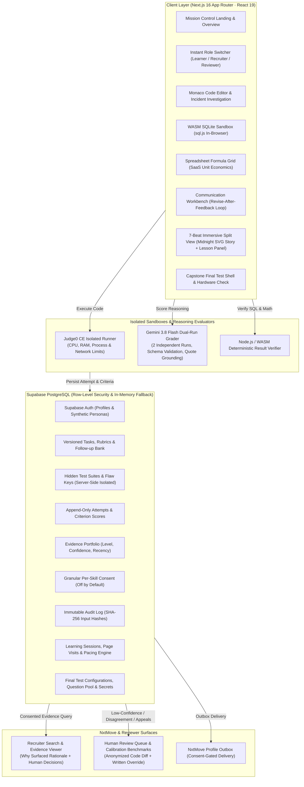

# ProofLoop (NextLearn) — Comprehensive Project Summary

**ProofLoop (NextLearn)** is an authentic, learner-owned **Proof-of-Skill Sandbox and Evidence Engine** built for the **Samartha Hackathon (Part A: Nyeras / NxtMove Sandbox)**.

The platform replaces multiple-choice trivia and gamified proxies with **real-world work samples**, deterministic test execution, and adaptive oral/written defenses. Learners generate **criterion-level evidence** that is shared with recruiters strictly under **granular, revocable learner consent**.

> **Important Boundary & Disclaimer**: Demonstrated skills reflect performance on these specific sandbox challenges only. ProofLoop explicitly claims **no automated hiring predictions** and **no general intelligence evaluation**. Human judgment remains the final authority.

---

## 1. High-Level Architecture & Tech Stack

### Technical Foundation
- **Framework:** Next.js 16 (App Router + Turbopack), React 19, TypeScript.
- **Styling & Tokens:** Strict 10-token CSS variable design system, Tailwind CSS, Lucide icons, full WCAG 2.1 AA accessibility.
- **Database & RLS:** Supabase PostgreSQL with Row-Level Security (RLS) policies, server-side admin client, and seamless in-memory fallback stores for test and offline environments.
- **Execution Engines:**
  - **Judge0 CE v1.14.0:** Isolated sandboxed code execution for Java & JavaScript.
  - **sql.js (WASM SQLite):** In-browser query engine with deterministic row verification.
  - **Google Gemini 3.8 Flash:** Structured dual-run JSON evaluation with Zod schema validation and mandatory text citation grounding.

---

## 2. Core Non-Negotiables & Ethical Principles

1. **No Gamification Pressure:** Zero XP, streaks, levels, leaderboards, or countdown pressure (outside of designated focus pacing and final test timers). Progression and unlocks come **only from demonstrated competency**.
2. **Deterministic Correctness; AI for Reasoning Only:** Code and math correctness is evaluated 100% deterministically by tests and query plans. Gemini evaluates *written justifications and diagnostic rationale only* via two independent runs.
3. **Zero Secret Leakage:** Hidden test suites, reference implementations, planted bug lines, and answer keys never reach the client bundle or public API responses (verified by CI leak tests).
4. **Consent-Gated Privacy (Off by Default):**
   - Sharing is per-skill, granular, and instantly revocable.
   - Code submissions and incident reports require separate secondary consent.
   - Recruiters see consented evidence only.
5. **Adaptive Follow-Up Questions Affect Confidence Only:** Follow-up questions resolve ambiguity and adjust confidence tiers (High / Medium / Low). They **never reduce the base criterion score**.
6. **Linguistic Neutrality:** Prompt guardrails strictly prohibit penalizing dialect, phrasing style, or non-native English grammar.
7. **Immutable Audit Trail:** Append-only audit log recording every submission, model output, input SHA-256 hash, consent change, and human review override.
8. **Human Judgment is Authoritative:** Automated systems cannot reject candidates; final hiring decisions remain human-driven.

---

## 3. Four Core Functional Pillars

### Pillar 1: Incident Debugging Sandbox (Technical Depth)
- **4 Real-World Incident Missions:**
  1. *The Wrong Top Seller* (JavaScript / API Sorting & Pagination)
  2. *Payment Double Charge* (Java / Concurrency & Idempotency)
  3. *Cache Invalidation Nightmare* (JavaScript / Redis Key TTLs)
  4. *Inventory Deadlock* (Java / SQL Transaction Order)
- **Dual-View Workspace:** Seamless toggle between **Incident Story** and **Plain Task Specification**.
- **Monaco Code Editor:** Embedded IDE with syntax highlighting, test execution, and real-time error feedback.
- **4-Part Incident Report:** Learners document Summary, Root Cause, Fix Rationale, and Verification Steps.
- **Skill Tree & Boss Round:** Prerequisite-based unlock visualization. Features *"Catch the AI's Mistake"* where candidate assertions execute against 3 code versions (flawed, reference, alternate) to defeat trivial cheats like `assert false`.
- **Reviewer Appeals & Dispute Workflow:** Instant routing of low-confidence or candidate-challenged evaluations to human reviewers.

---

### Pillar 2: Immersive Learning Paths & Focus Engine
- **3 Practice Paths:** Data Analytics, Business Analytics, Workplace Communication (10 modules each = 30 modules total).
- **Split-Screen Immersive View:**
  - **Left (Midnight `#142D4E`):** Original SVG illustrations and ongoing narrative arcs (*Meera at Quickbite*, *Rohan at ChaiCraft*, *Ananya at CloudScale*).
  - **Right (Clean White Canvas):** 7-beat pedagogical lesson progression:
    1. *Curiosity Teaser* (predict before seeing the lesson)
    2. *Story Scene* (contextual narrative)
    3. *Core Concept* (bite-sized principles with interactive glossary popovers)
    4. *Worked Example* (production scenario walkthrough)
    5. *Try-It First* (low-stakes interactive trial)
    6. *Knowledge Check* (server-graded formative check, pass 2 of 3 to advance)
    7. *Key Takeaway* (summary card)
- **Authentic Interactive Work Samples:**
  - **WASM SQLite (`sql.js`):** In-browser SQL execution on live eCommerce order tables.
  - **Spreadsheet Formula Grid:** Interactive formula evaluation for SaaS metrics (CAC, LTV, Payback).
  - **Communication Workbench:** Revise-after-feedback loop on critical stakeholder memos.
- **Calm Reading Pacing Ring (`ReadingRing`):** Server-enforced reading pacing (`clamp(ceil(words / 3.8 * 0.6), 8, 90)`) with per-beat key remounting and zero render-loop side effects.
- **Focus Session Engine:** Heartbeat monitoring (30s timeout), single active session lock, 3-second grace period for accidental tab switches, pause/resume controls, and an accessible Relaxed Focus Mode.
- **Formative Milestone Reflections:** Interactive reflection checkpoints after Modules 3, 6, 9, and Capstone 10 evaluated by Gemini with supportive qualitative feedback.

---

### Pillar 3: Capstone Final Test Certification Engine
- **Strict Unlock Criteria:** Unlocks only after completing all 10 modules and all 3 reflection checkpoints in a path.
- **72+ Authentic Workplace Questions ($\ge 24$ per path):** Balanced randomized draw of 8 questions per attempt across 6 workplace archetypes:
  1. *Spot the AI's Mistake* (planted error span detection + deterministic scoring + AI rationale check)
  2. *Case Decision* (ambiguous operational triage + written defense)
  3. *Fix It* (broken SQL execution, spreadsheet formulas, or unformatted drafts)
  4. *Interpret* (misleading dual-axis charts, truncated scales, Simpson's paradox)
  5. *Triage / Prioritise* (capacity and constraint trade-offs)
  6. *Rewrite* (executive BLUF, de-escalating scope creep, respectful feedback)
- **Authoritative Server Timer:** 45-minute limit (or 67.5 minutes under +50% accessibility accommodation) enforced strictly server-side with 10m/2m visual warnings and automatic expiration submission.
- **Tiered Hints with Deductions:** Nudge (-5%), Pointer (-10%), Strong Hint (-20%) capped at 35% total deduction per question with explicit confirmation dialogs.
- **100% Local Hardware Verification:**
  - Local `getUserMedia` camera preview and microphone volume meter.
  - **Zero Media Recording / Streaming:** 0 `MediaRecorder`, 0 canvas capture, 0 remote streaming. Verified by security audits.
  - Neutrally labeled *"Take without camera & mic"* option is always available.
- **Optimality & Defense Scoring:**
  - Technical: 60% Correctness + 40% Query Optimality (indexes, execution plans, explicit joins).
  - Non-technical: 80% Base + 20% Follow-up Defense.
- **Adaptive Follow-Up Early Stop:** Gemini dual-run evaluation. If initial defense demonstrates proficiency, questioning stops early with High Confidence.
- **Retake Cooldown:** Mandatory 24-hour retake cooldown to encourage deliberate practice over brute force.

---

### Pillar 4: Evidence Portfolio, Recruiter Search & Reviewer Surface
- **Evidence Portfolio (`/`):**
  - Multi-skill evidence cards highlighting demonstrated level (*Developing*, *Proficient*, *Advanced*), confidence (*High*, *Medium*, *Low*), and recency.
  - Two-tier granular consent toggles: profile visibility and submission source code disclosure.
- **NxtMove Recruiter Search:**
  - Role-based candidate search (e.g., Junior Java Developer, Junior Data Analyst).
  - Explicit **"Why Surfaced"** rationales showing exact rubric alignment.
  - Recruiter shortlist notes and hiring decision recording.
- **Reviewer Queue & Calibration:**
  - Anonymized peer similarity diffs.
  - Mandatory written override justifications ($\ge 10$ characters).
  - Benchmark calibration panel tracking human vs. AI scoring agreement.

---

## 4. Design System & UI/UX Standards

The entire application uses a **"Mission Control for Skills"** visual identity:
- **Strict 10-Token Palette:**
  - `#FFFFFF` Canvas
  - `#142D4E` Midnight (Headers, navigation, primary surfaces)
  - `#06C6E6` Cyan (Action points, progress, indicators)
  - `#EAF6FC` Ice (Subtle backgrounds and card borders)
  - `#334155` Text (High-contrast charcoal body text)
  - `#64748B` Muted (Secondary text and metadata)
  - `#D9E8F3` Border (Structural division)
  - `#059669` Success | `#D97706` Warning | `#DC2626` Error
- **Accessibility & Contrast:** Every text-background pair meets WCAG 2.1 AA ($\ge 4.5:1$).
- **Interaction & Ergonomics:**
  - Command Palette (`Ctrl/Cmd + K`) for instant page and mission jumping.
  - Keyboard shortcut sheet (`?`).
  - Screen-reader live regions (`aria-live="polite"`).
  - Full `prefers-reduced-motion` compliance across all transitions.

---

## 5. Verification & Test Suite Matrix

The codebase is thoroughly tested with automated Vitest suites and compiles with zero warnings:

| Quality Gate / Test Suite | Scope & Verification | Result |
| :--- | :--- | :---: |
| **Linter & Type Check** | `npm run lint` & Turbopack TypeScript build | **PASS (0 errors)** |
| **Next.js Production Build** | Compiles all 39 static and dynamic routes | **PASS (39 / 39 routes)** |
| `tests/accessibility.test.ts` | Contrast tokens, focus rings, reduced motion, ARIA progressbars | **PASS (7/7)** |
| `tests/leak-protection.test.ts` | Ensures hidden tests, flaw keys, and reference answers never leak | **PASS (5/5)** |
| `tests/two-user-rls.test.ts` | Validates Supabase RLS isolation between candidate accounts | **PASS (3/3)** |
| `tests/consent-and-profile.test.ts` | Per-skill consent gating and two-tier submission opt-in | **PASS (4/4)** |
| `tests/recruiter-search.test.ts` | Consented candidate surfacing, notes, and outbox delivery | **PASS (4/4)** |
| `tests/work-samples.test.ts` | SQLite execution, spreadsheet math, and communication loops | **PASS (7/7)** |
| `tests/stop-rule-and-confidence.test.ts` | Adaptive follow-up confidence adjustments without point loss | **PASS (6/6)** |
| `tests/followup-selector.test.ts` | Fixed bank question rotation and ambiguity detection | **PASS (4/4)** |
| `tests/reviewer-and-audit.test.ts` | Anonymized diffs, written override checks, and audit hashes | **PASS (3/3)** |
| `tests/learning-session-engine.test.ts` | Single-session locks, word-count reading pacing, tab-switch grace | **PASS (7/7)** |
| `tests/learning-reflection-and-unlock.test.ts` | Milestone reflections, formative feedback, and final test unlock | **PASS (4/4)** |
| `tests/final-test-engine.test.ts` | Server timer, hint deductions, zero media recording audit, optimality | **PASS (14/14)** |
| **Total Automated Tests** | `npm test` | **68 / 68 PASS (100%)** |

---

## 6. Synthetic Personas for Quick Demonstration

Switch between roles instantly in the top bar without re-authenticating:
- **Alex Morgan (`cand_0142`) — Learner:** Explores learning paths, solves missions, completes reflections, and toggles evidence consent.
- **Priya Sharma (`rec_priya`) — Recruiter:** Searches candidates by skill, reviews evidence quotes, inspects "Why surfaced" rationales, and shortlists candidates.
- **Dr. Sarah Chen (`rev_sarah`) — Reviewer:** Audits low-confidence attempts, inspects peer similarity diffs, overrides scores with written justifications, and monitors benchmark agreement.
